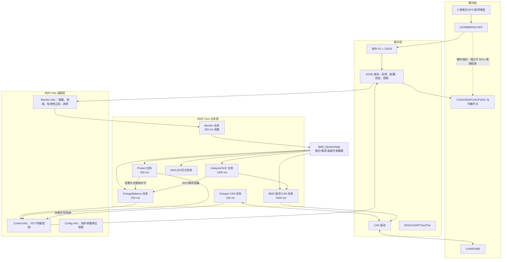
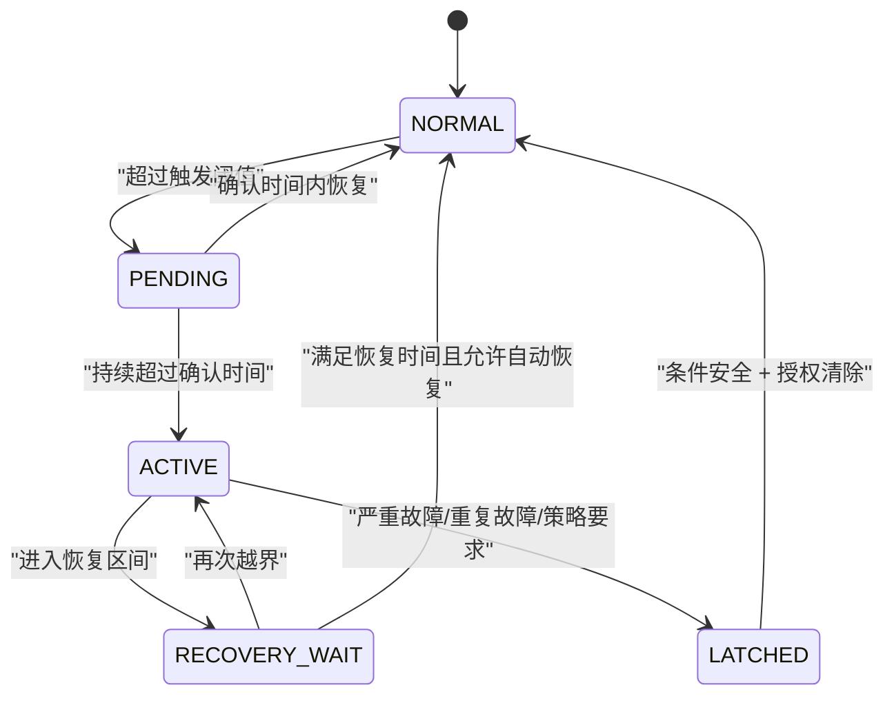

# BMS 软件架构、SOC 算法、保护与均衡面试问答

> 本文依据当前 GD32C11x + GD30BM2016 五串 BMS 工程整理。
>
> - **工程现状**：源码中已经实现或能够直接确认的行为。
> - **建议方案**：工程目前没有完整实现，但量产项目应补充的设计。
>
> 面试时应主动区分这两类内容，不能把建议方案描述成已经完成的功能。

## 工程现状总览

| 项目 | 当前实现 |
| --- | --- |
| MCU/RTOS | GD32C11x，CMSIS-RTOS2 封装 FreeRTOS；工程目标配置为 Cortex-M4 + FPU |
| AFE | GD30BM2016，五串电芯，软件 I²C，支持 CRC8 模式探测 |
| 数据共享 | 主要通过 `BMS_MonitorData`、`BMS_AnalysisData`、`BMS_ProtectAlert` 等全局变量共享 |
| SOC | 最低单体 OCV 初始化 + 安时积分 + 静置 OCV 渐进修正 |
| 保护 | AFE 硬件保护与 200 ms 软件保护任务并行 |
| 均衡 | 外部被动均衡，最多选择 3 节非相邻高压电芯 |
| 通信 | BMS 遥测 CAN 任务 2 s；充电器 CAN 任务 100 ms；CAN 接收采用轮询 |
| 参数持久化 | 当前没有应用层 Flash 参数、SOC 或故障记录模块 |
| 看门狗 | 当前没有启用独立看门狗或窗口看门狗 |

> **配置文件注意事项**：工程中两个 `bms_config.h` 实际上可能分别作用于不同源文件。`Code/Bms/bms_app.c` 会优先包含同目录下的 `Code/Bms/bms_config.h`，而 `Code/Bms/Core/*.c` 会优先包含 `Code/Bms/Core/bms_config.h`。这会造成 AFE 初始化参数与 Core 软件参数来源不唯一，量产前应合并成一个配置源并增加编译期一致性检查。

---

# 二、BMS 软件架构

## 2.1 ★ 请画出 BMS 软件架构和主要任务的数据流。



主要数据流是：

1. GD30BM2016 从电芯、NTC 和采样电阻获得原始测量值。
2. AFE 驱动通过软件 I²C 读取寄存器并完成 CRC8 校验。
3. HAL 层进行单位换算、增益/零点修正、范围判断和电芯排序。
4. Monitor 任务把结果写入 `BMS_MonitorData`。
5. Protect、Analysis、Energy、CAN 和 Info 任务读取这些数据，分别完成保护、SOC、均衡/输出控制、通信和显示。
6. 保护与能量管理通过 Control HAL 控制 AFE 内的充放电 FET 和均衡位。

当前工程采用共享全局变量，而不是消息队列或只读快照。小型项目能够工作，但更严谨的架构应由采集任务发布带时间戳的完整快照，其他任务只读该快照，避免读取到一次采样更新过程中的半新半旧数据。

## 2.2 系统划分了哪些软件模块？

系统可分为以下模块：

1. **板级支持层**：时钟、GPIO、SysTick、USART、CAN 外设初始化。
2. **底层驱动层**：软件 I²C、GD30BM2016、CAN、RS485。
3. **HAL 适配层**：采样校准与过滤、保护参数配置、FET 和均衡控制。
4. **Monitor 模块**：调度电压、电流、温度采样并判断充电、放电、待机模式。
5. **Protect 模块**：执行软件保护状态机，并接收 AFE 硬件告警。
6. **Analysis 模块**：计算最大/最小/平均电压、压差、功率、容量和 SOC。
7. **Energy 模块**：管理充电、放电、预充、预放以及均衡。
8. **Charger 模块**：通过 CAN 与充电器交互，发送目标电压、电流和使能状态。
9. **Comm 模块**：周期发送 BMS 总压、电流、SOC、告警和单体电压。
10. **Info 模块**：串口日志和 SOC LED 显示。
11. **Global/Config 模块**：保存全局运行状态和编译期参数。

## 2.3 电压、电流、温度数据的采集周期分别是多少？

| 数据 | 当前周期 | 说明 |
| --- | ---: | --- |
| 单体电压 | 250 ms | Monitor 每次循环读取全部配置单体 |
| 电池包总压 | 250 ms | 与单体电压同周期 |
| 温度 | 2000 ms | 当前配置 1 路温度 |
| 电流 | 1000 ms | 周期读取 CC2 电流 |
| AFE 电流告警触发读取 | 设计上最快约在下一次 250 ms Monitor 循环处理 | 当前 `GD30BM2016_ALERT_Pin` 为 0，外部告警链路没有真正接通，因此实际仍以 1 s 周期为主 |

这些是软件读取周期，不等同于 AFE 内部 ADC 转换周期。

## 2.4 采集、SOC 计算、保护判断、均衡控制和 CAN 通信如何调度？

FreeRTOS 使用抢占式调度，当前任务关系如下：

| 功能 | 周期 | CMSIS 优先级 |
| --- | ---: | --- |
| 采集 Monitor | 250 ms | `osPriorityNormal5` |
| 软件保护 Protect | 200 ms | `osPriorityNormal4` |
| Analysis/SOC | 1000 ms | `osPriorityNormal3` |
| Energy/Balance | 200 ms | `osPriorityNormal2` |
| Charger CAN | 100 ms | `osPriorityNormal1` |
| BMS 遥测 CAN | 2000 ms | `osPriorityNormal1` |
| Info LED | 500 ms | `osPriorityNormal1` |
| Info 日志 | 2000 ms | `osPriorityNormal1` |

调度逻辑是：Monitor 优先更新共享数据；Protect 以更短的 200 ms 周期检查；Analysis 每秒积分一次；Energy 每 200 ms 根据保护、SOC 和模式控制输出与均衡；CAN 分为 100 ms 充电器控制和 2 s BMS 遥测。

当前使用 `osDelay()`，实际周期是“本次执行时间 + 延时时间”。对 SOC 积分影响较小，因为代码使用系统 Tick 计算真实 `dt`；对严格周期任务，建议改为绝对周期唤醒或软件定时基准。

## 2.5 哪些功能放在中断中，哪些放在任务中？

**当前工程中断内容：**

- SysTick 中断：驱动 FreeRTOS Tick 和阻塞延时计数。
- USART1 中断：接收一个 RS485 字节并立即回显。
- EXTI10_15 中断：当前只清除 EXTI12 标志。
- CAN：当前没有使用接收中断，由 Charger 任务轮询 FIFO。
- AFE ALERT：驱动中有回调接口，但 `GD30BM2016_ALERT_Pin` 当前为 0，实际未接通。

**当前任务内容：**

- I²C 寄存器读取、采样换算、SOC、保护判断、均衡选择、FET 控制、CAN 收发和日志均在任务或 RTOS 定时器回调中执行。

**推荐原则：**中断只做清标志、读取必要状态、记录时间戳、置事件位或发送任务通知；I²C 访问、CRC、滤波、SOC、保护状态机和协议解析全部放到任务中。当前 `GD30BM2016_EXTI_Callback()` 内部会读取三个安全状态寄存器，如果未来把它直接放入 EXTI ISR，会违背这一原则，应改成 ISR 通知高优先级保护任务后再读取。

## 2.6 为什么不能在 ADC 或通信中断中执行复杂算法？

原因包括：

1. 中断执行过久会增加其他中断延迟，影响软件 I²C、系统 Tick、CAN 和保护响应。
2. SOC、滤波或协议解析的执行时间不固定，不利于最坏执行时间分析。
3. 中断栈通常较小，浮点运算和格式化输出会明显增加栈压力。
4. ISR 中不能安全调用普通阻塞 API，例如 `osDelay()`、等待互斥锁或轮询 I²C。
5. 长 ISR 可能导致 CAN FIFO 溢出、采样丢失或 FreeRTOS 调度延迟。

正确方式是让 ISR 产生一个轻量事件，由相应高优先级任务完成后续处理。

## 2.7 AFE 驱动向上层提供了哪些接口？

当前 `drv_softi2c_gd30bm2016.h` 提供的接口可分为：

- **初始化与模式控制**：`GD30BM2016_Initialize()`、`GD30BM2016_Wakeup()`、`GD30BM2016_EntryShip()`。
- **告警入口**：`GD30BM2016_EXTI_Callback()`，初始化时可注册 OCD、SCD、OV、UV、CC、Device、OVRD 回调。
- **采样更新**：`GD30BM2016_UpdateCellVolt()`、`UpdateTsTemp()`、`UpdateDieTemp()`、`UpdateCurrent()`、`UpdateBatVolt()`。
- **测量缓存**：全局 `GD30BM2016_SampleData`，保存电芯电压、温度、电流和总压。
- **输出控制**：`GD30BM2016_ControlDSGOrCHG()`、`GD30BM2016_CellBalanceControl()`。
- **状态检测**：`GD30BM2016_LoadDetect()`。
- **保护配置**：SCD/OCD/OV/UV 延时和 OV/UV 阈值设置接口。

当前采样更新接口返回 `void`，通信失败时通常保留上一次缓存值。因此更好的接口应返回状态码，并同时输出本次数据的有效位和时间戳。

## 2.8 如何统一管理传感器采集错误？

**工程现状：**单体电压使用 1.0～5.0 V 范围过滤；温度使用 -55～125 ℃ 范围过滤，并把 0 ℃当作无效；但电流和总压没有完整的有效性状态。AFE 读取失败后可能继续使用旧值，也没有统一的错误计数、数据年龄和故障位。

**建议方案：**定义统一测量快照：

```c
typedef struct {
    float value;
    uint32_t timestamp_ms;
    uint16_t error_count;
    uint8_t valid;
    uint8_t stale;
    uint8_t error_code;
} BMS_SensorValue;
```

每个通道至少记录：本次是否成功、最近成功时间、连续失败次数、范围错误、CRC 错误、NACK、跳变错误。采集模块发布完整快照；保护模块根据数据质量执行降级或关断，而不是静默沿用旧数据。

## 2.9 ★ CRC8 重试机制是怎样的？

当前 CRC8 多项式为 `0x07`，初值为 0。读取帧校验内容包括写地址、命令、读地址和返回数据；写帧 CRC 包括写地址、命令和数据。

需要区分三类“重试”：

1. **上电 CRC 模式探测**：优先使用 CRC 模式读取 Battery Status，最多尝试 3 次、间隔 1 ms，至少成功 2 次才确认 CRC 模式；之后才尝试一次非 CRC 读取。
2. **I²C 地址 NACK 重试**：`i2c1.retries = 3`，底层循环条件是 `i <= retries`，所以地址阶段最多发送 4 次，即首次发送加 3 次重试；每次之间执行 STOP、约 1 μs 延时和重新 START。
3. **地址/唤醒探测**：4 个候选地址最多扫描 5 轮，轮次之间发送唤醒脉冲并等待 10 ms。

普通运行期读取并没有完整的“CRC 失败后重试 3 次”逻辑：当前模式读取失败后，只有在原本处于非 CRC 模式时才会额外尝试一次 CRC 模式；处于 CRC 模式时一次失败就返回失败。写操作也没有通用 CRC 重试。

## 2.10 最多重试多少次？重试间隔如何确定？

按当前代码：

- CRC 模式确认最多 3 次，间隔 1 ms，需要其中 2 次成功。
- I²C 地址最多尝试 4 次，重启总线间隔约 1 μs。
- 候选地址/唤醒探测最多 5 轮，间隔 10 ms。

这些数字来自不同层，不能混为“CRC 最多重试 4 次”。

量产设计中建议普通事务最多执行 3 次总尝试，并采用短退避，例如 1 ms、2 ms、5 ms；具体间隔应依据 AFE 数据手册的命令处理时间、ADC 更新周期和示波器实测确定。保护任务不能在一个周期内无限重试。

## 2.11 连续重试失败后如何恢复 AFE？

**工程现状：**上电初始化已经具备时钟唤醒、唤醒脉冲、候选地址探测、RST_SHUT 时序、TS2 手动唤醒、三次芯片复位命令和重新配置流程；但运行期没有“连续失败计数 → 总线恢复 → AFE 重初始化”的自动状态机。

**建议恢复层级：**

1. 单次失败：丢弃本次数据并有限重试。
2. 连续失败达到阈值：发送 STOP，释放 SDA/SCL，输出 9 个 SCL 脉冲恢复总线。
3. 再失败：重新探测地址与 CRC 模式，执行唤醒命令。
4. 仍失败：先关闭 CHG/DSG，再执行 AFE 硬件复位和完整配置。
5. 配置后读回关键保护寄存器，并获得连续若干帧有效采样，才能退出恢复状态。
6. 最终失败：保持安全关断，锁存 AFE 通信故障并等待人工处理或系统复位。

## 2.12 AFE 恢复期间保护功能如何保证？

不能假设 AFE 复位期间硬件保护一定始终有效。安全策略应为：

- 恢复前先关闭充电和放电通路，并锁存 `AFE_COMM_FAULT`。
- 停止均衡，禁止充电器使能。
- 若 AFE 仍在线，其硬件 SCD/OCD/OV/UV 保护作为第一道保护；同时应有保险丝或二级硬件保护作为最终兜底。
- 不使用过期采样做“恢复正常”的判断。
- 重新配置后必须读回阈值、延时和 FET 状态，并连续获得有效数据，才允许重新开启输出。

当前工程没有完成这一运行期恢复闭环。

## 2.13 如何防止通信任务阻塞整个系统？

当前 CAN 发送只申请邮箱，不等待发送完成；Charger 接收每周期最多处理 8 帧，避免 FIFO 持续有数据时形成无限循环。这两个设计能够限制单次执行时间。

仍需注意：调试串口采用轮询输出；软件 I²C 在整次事务期间关闭全局中断；大量日志或异常总线可能影响实时性。建议：

- 接收 ISR 只入环形缓冲区或发送队列通知。
- 协议解析在通信任务完成，每周期限制最大帧数和 CPU 时间预算。
- 发送使用队列和超时，禁止无限等待邮箱、互斥锁或应答。
- 调试日志使用低优先级异步缓冲，保护路径不得格式化大量浮点日志。
- I²C 使用硬件控制器或总线互斥锁，并限制每次事务和重试的最坏时间。

## 2.14 BMS 上电后的软件初始化顺序是什么？

当前顺序为：

1. 配置 SysTick。
2. 初始化 GPIO，并把输出设置到默认电平。
3. 初始化调试串口、RS485 串口和 CAN。
4. 初始化 CMSIS-RTOS2 内核。
5. 创建高优先级一次性 `BMS_StartTask`，启动调度器。
6. 启动任务中初始化软件 I²C。
7. 初始化 GD30：注册告警回调、唤醒、探测地址/CRC 模式、进入配置、写入保护参数、等待首次扫描。
8. 首次读取单体电压、总压、温度和电流。
9. 根据配置执行均衡通道自检。
10. 依次创建 Monitor、Protect、Analysis、Energy、Info、Comm 和 Charger 任务。
11. 启动任务退出并释放自身栈。

## 2.15 初始化到一半失败时如何回退？

**工程现状：**AFE 初始化失败会返回 `false`，最终进入 `Error_Handler()`，关闭中断并永久停机；但后续业务任务创建失败只打印日志，不会使系统初始化失败，也没有删除已经创建的任务、定时器和信号量。

**建议方案：**初始化采用阶段状态机。默认保持 FET 和均衡关闭；先验证硬件、参数和 AFE，再统一创建任务。任一阶段失败时：

1. 关闭 CHG、DSG、PCHG、PDSG 和全部均衡。
2. 停止充电器控制输出。
3. 删除已经创建的 RTOS 对象，或转入只保留诊断通信的安全模式。
4. 记录失败阶段与错误码。
5. 对可恢复错误限次重试；不可恢复错误等待看门狗复位或人工干预。

## 2.16 MCU 复位后如何恢复运行状态？

当前 MCU 复位后所有 RAM 状态清零，重新配置 AFE、重新采样，并用最低单体 OCV 重新初始化 SOC；不会恢复掉电前 SOC、故障、均衡进度或输出状态。

建议复位后读取复位原因和双备份 Flash 记录，但只恢复 SOC、SOH、累计电量、故障历史等非执行状态。FET 和均衡不能直接恢复为复位前状态，必须保持安全默认值，重新验证 AFE 配置、传感器数据、保护状态和外部请求后再由状态机决定是否开启。

## 2.17 看门狗由谁喂？如何避免“任务已经死锁但仍然喂狗”？

当前工程没有启用 FWDGT/WWDGT，因此没有实际喂狗任务。

推荐设置独立的健康监督任务，只有它能喂看门狗。Monitor、Protect、Energy、CAN 等关键任务分别更新自己的心跳计数和最后成功时间；监督任务必须确认：

- 所有关键任务都在各自截止时间内推进过；
- AFE 采样时间戳持续更新；
- 保护状态机可以运行；
- 没有栈溢出、死锁、调度超时或严重内存错误；

全部满足时才喂狗。不能由 Idle 任务无条件喂狗，也不能让每个任务各自喂狗，否则一个仍运行的非关键任务可能掩盖关键任务死锁。

## 2.18 如何记录复位原因和故障现场？

当前 HardFault 等异常处理只是死循环，没有保存现场；也没有读取 MCU 复位标志。

建议在启动最早阶段读取并保存上电、外部复位、软件复位、看门狗、欠压等复位原因。HardFault 中使用无锁、无动态内存的最小处理程序保存 PC、LR、SP、关键故障寄存器、当前任务、保护位和最近采样时间戳。可先写入备份寄存器或保留 RAM，下一次启动后再转存到带 CRC 的 Flash 故障日志，避免在异常上下文中执行复杂 Flash 操作。

## 2.19 参数如何保存在 Flash 中？

当前保护阈值、SOC 参数和均衡参数来自两个 `bms_config.h` 的编译期宏，再复制到 RAM 结构体；没有应用层 Flash 参数管理。

建议定义版本化记录：

```c
typedef struct {
    uint32_t magic;
    uint16_t version;
    uint16_t length;
    uint32_t sequence;
    BMS_Config payload;
    uint32_t crc32;
    uint32_t commit;
} BMS_ConfigRecord;
```

启动时检查 magic、版本、长度、参数范围、参数间关系和 CRC；有效后加载，无效则使用只读安全默认参数并上报配置故障。

## 2.20 如何保证参数写入过程中断电后仍然有效？

采用 A/B 双槽或日志式写入：

1. 永远不直接覆盖当前有效槽。
2. 擦除另一个槽，写入新 payload、版本、序号和 CRC。
3. 读回校验全部内容。
4. 最后单独写入 `commit` 标记，使新槽原子生效。
5. 启动时选择 CRC 正确且序号最新的已提交记录。

如果写入中途掉电，旧槽仍有效；新槽因为没有 commit 或 CRC 不正确而被忽略。

---

# 三、SOC 算法

## 3.1 ★ 介绍“OCV 初始化＋安时积分＋静置 OCV 修正”的完整流程。

1. **上电采样**：读取并校准各单体电压，过滤无效通道并从低到高排序。
2. **OCV 初始化**：取最低有效单体电压，在 101 点 OCV-SOC 表中查表并线性插值，得到 0～1 的初始 SOC。
3. **容量同步**：令 `CapacityRemain = CapacityReal × SOC`。
4. **运行积分**：Analysis 任务每 1 s 根据真实 Tick 差值和当前充放电模式进行安时积分；充电效率为 0.995，放电效率为 1.0。
5. **边界限制**：剩余容量限制在 0～实际容量之间，SOC 限制在 0～1。
6. **静置判定**：当前实现要求 `|I| <= 30 mA` 连续 5 min。
7. **OCV 修正**：进入静置后每 30 s 计算最低单体对应的 OCV-SOC，每次修正当前误差的 5%，单次最多改变 0.5% SOC。

## 3.2 安时积分公式是什么？

放电时：

\[
Q_{remain,k}=Q_{remain,k-1}-\eta_d\frac{|I_k|\Delta t}{3600}
\]

充电时：

\[
Q_{remain,k}=Q_{remain,k-1}+\eta_c\frac{|I_k|\Delta t}{3600}
\]

\[
SOC_k=\frac{Q_{remain,k}}{C_{real}}
\]

当前代码的时间单位是毫秒，因此实际分母为 `1000 × 3600`。代码还把单次 `dt` 限制为最多 5000 ms，防止任务长时间停顿后一次补积分过大。

## 3.3 时间单位为秒、容量单位为 Ah 时为什么要除以 3600？

因为 1 小时等于 3600 秒：

\[
A\cdot s \div 3600 = A\cdot h
\]

如果忘记除以 3600，就会把安秒直接当成安时，积分结果放大 3600 倍。

## 3.4 ★ 如何判断电池进入静置状态？

当前实现只要求：SOC 已初始化、有有效单体、`|I| <= 30 mA` 且持续 5 min。电流一旦超过阈值，静置计时立即清零。

更可靠的静置条件应同时包括：

- 小电流持续达到设定时间；
- 一段窗口内单体电压变化率足够小；
- 充电器和外部负载处于确定状态；
- 均衡已关闭并经过电压恢复等待；
- 温度变化较小；
- 采样有效且没有通信故障。

## 3.5 为什么只判断 `|I| < 30 mA` 可能误判？

因为以下情况都可能落在 30 mA 内，但并非真正开路静置：

- 真实存在 20 mA 待机负载或涓流充电；
- 电流零点偏差、死区或分辨率掩盖了小电流；
- 均衡电阻正在放电，但电流没有经过主采样电阻；
- 刚停止大电流，极化电压仍在缓慢恢复；
- 低温或老化电池需要更长的电化学松弛时间。

因此“小电流”只是必要条件，不是充分条件。

## 3.6 如何结合持续时间和电压变化率判断静置？

可维护一个 5～30 min 的滑动窗口，并同时判断：

\[
|I| < I_{rest}
\]

\[
\left|\frac{dV_i}{dt}\right| < K_{rest},\quad \forall i
\]

工程上可以用窗口首尾差、最大值减最小值或线性回归计算 `dV/dt`。阈值不能凭空确定，应根据电芯体系、温度和静置试验标定。任一条件不满足就重置静置计时；均衡关闭后还应先等待 RC 和极化影响衰减。

## 3.7 OCV-SOC 表如何存储？

当前使用 `uint16_t SocOcvTab[101]`，单位为 mV，数组索引 0～100 对应 0%～100% SOC。该表作为常量关系写在程序代码中，但当前声明没有 `const`，会占用可写数据区；建议声明为 `static const uint16_t`，存放在程序 Flash，并为不同温度、不同电芯化学体系使用不同表。

## 3.8 查表时如何进行分段线性插值？

找到满足 `V[index] < Vin <= V[index+1]` 的区间，计算：

\[
SOC=SOC_i+\frac{V_{in}-V_i}{V_{i+1}-V_i}(SOC_{i+1}-SOC_i)
\]

当前表每个点相差 1% SOC，代码输出千分比：

```c
soc_permille = index * 10
              + (voltage - low) * 10 / (high - low);
```

如果相邻电压相同，则直接返回该段起点 SOC，避免除零。

## 3.9 查表输入超过范围时如何处理？

当前实现采用饱和处理：输入低于或等于表首电压返回 0%，高于或等于表尾电压返回 100%。同时应记录越界诊断；如果电压远超物理范围，应先判定传感器故障，不能仅仅把它钳位为 0% 或 100%。

## 3.10 OCV 结果与积分结果差异较大时如何融合？

当前融合公式是：

\[
e=SOC_{OCV}-SOC_{AH}
\]

\[
\Delta SOC=clip(0.05e,-0.005,+0.005)
\]

\[
SOC_{new}=SOC_{old}+\Delta SOC
\]

也就是每 30 s 消除 5% 的剩余误差，但单次最多改变 0.5 个百分点。更完善的方案还应根据静置时间、温度、OCV 平台区和单体一致性动态调整可信度。

## 3.11 为什么不能直接替换 SOC？

OCV 会受到极化、温度、迟滞、负载未完全消失、电压测量误差和电芯不一致影响。直接替换可能让显示瞬间跳变十几个百分点，也可能把一次异常电压变成错误 SOC。渐进融合既能修正长期积分漂移，又能保持用户看到的 SOC 连续。

## 3.12 ★ “每 30 秒修正误差的 5%”如何实现？

进入静置 5 min 后，保存 `LastOcvCorrectTick`。当距离上次修正达到 30000 ms 时：

```c
error = ocv_soc - soc;
correction = error * 0.05f;
correction = limit(correction, -0.005f, 0.005f);
soc += correction;
capacity_remain = capacity_real * soc;
```

例如积分 SOC 为 70%、OCV-SOC 为 90%，误差为 20%。理论 5% 修正量是 1%，但受单次 0.5% 限制，第一次只从 70% 变为 70.5%。

## 3.13 这个修正策略大约需要多久收敛？

不受 0.5% 上限限制时，剩余误差满足：

\[
e_n=0.95^n e_0
\]

每次间隔 30 s：

- 消除约 63% 初始误差约需 20 次，即约 10 min；
- 剩余误差降到初始误差的 10% 约需 45 次，即约 22.5 min；
- 剩余误差降到初始误差的 1% 约需 90 次，即约 45 min。

如果初始误差大于 10%，前期会受单次 0.5% 限制而线性收敛。例如误差 20%，先约 10 min 降到 10%，再约 22.5 min 降到 1% 绝对误差附近。上述时间还应加上进入修正前的 5 min 静置确认时间。

## 3.14 电流采样零点偏差如何造成 SOC 累计误差？

固定零偏会被安时积分持续累加：

\[
\Delta SOC=\frac{I_{offset}\times t}{C_{real}}
\]

例如 5 Ah 电池存在 +20 mA 偏差并运行 10 h：

\[
\Delta SOC=\frac{0.02\times10}{5}=4\%
\]

正负方向取决于项目电流符号约定。当前工程规定正电流为充电，因此正零偏会使 SOC 偏高。

## 3.15 如何在软件中校准零点偏差？

在确认主采样电阻真实电流为零的工况下，等待稳定后采集多次数据，剔除异常点并取中位数或均值作为 `I_offset`：

\[
I_{real}=(I_{measured}-I_{offset})\times Gain
\]

产线应做零点和增益标定；运行期只能在充放电通路确定断开、无均衡瞬态且状态持续稳定时进行慢速自适应。零点可能随温度变化，可建立温度分段补偿。当前配置中的零点为 0、增益为 1，还没有实测标定数据。

## 3.16 如何避免把真实小电流错误地校准为零？

零点校准必须依赖“硬件上确定没有电流”的状态，不能仅依赖 `|I|` 很小。不要使用“低于 30 mA 就把当前值当零点”的逻辑。若已标定零偏为 +20 mA，真实负载为 20 mA，则传感器约读到 40 mA，减去零偏后仍得到真实的 20 mA。

电流死区只应覆盖测量噪声，并通过试验确定。当前工程使用 ±10 mA 死区，可能漏计长期微小待机电流，需要结合系统最低真实负载评估。

## 3.17 SOC 多久更新一次？为什么？

当前 Analysis 任务每 1000 ms 运行一次，SOC 因此约每秒更新。电流也每秒周期读取一次，与积分频率匹配。SOC 是慢变量，1 Hz 足以支持显示和能量管理；短路、过流等快速安全功能不依赖 SOC，而由 AFE 硬件和 200 ms 软件保护处理。

## 3.18 SOC 计算使用浮点还是定点？

当前使用 `float`：电流、电压、容量、效率和 SOC 都以浮点计算；OCV 表和查表中间结果使用整数 mV/千分比。

定点方案可把电流表示为 mA、时间表示为 ms、累计电量表示为 mA·ms 或 μAh、SOC 表示为 ppm。定点更容易做确定性和溢出分析，但实现复杂度更高。当前 1 Hz 计算负载很低，使用浮点是合理的，但必须做好边界、NaN 和编译器配置测试。

## 3.19 无 FPU 单片机上使用浮点有什么影响？

无 FPU 时，编译器会调用软件浮点库，带来更长执行时间、更大代码体积和更高栈消耗；浮点 `printf` 的影响尤其明显。保护 ISR 或高频控制环不应依赖复杂浮点运算。

本工程 Keil 目标配置显示为 Cortex-M4 + FPU，因此普通加减乘除可使用硬件浮点，1 Hz SOC 计算压力不大；但日志中的浮点格式化仍会显著占用代码和栈。

## 3.20 SOC 掉电前如何保存？

当前没有保存 SOC，复位后重新用 OCV 初始化。

建议保存 SOC、剩余容量、可用容量、累计充放电量、时间戳、保存原因、版本、序号和 CRC。优先在检测到受控关机、进入休眠或外部电源掉电预警时保存；不能把安全输出状态直接作为下次启动时的恢复命令。

## 3.21 如何减少频繁保存造成的 Flash 磨损？

可组合使用：

- SOC 变化超过阈值时才置脏标志，例如变化 1%；
- 每 5～10 min 最多保存一次；
- 受控关机或休眠前强制保存；
- 多页轮转磨损均衡，而不是反复擦写同一页；
- 只在数据变化时写入；
- 使用 FRAM/EEPROM 时仍保留 CRC 和断电一致性设计。

## 3.22 如何判断 Flash 中的 SOC 数据是否有效？

至少检查 magic、结构版本、长度、序号、CRC、SOC 是否在 0～100%、容量范围是否合理、保存时间和复位原因。还应比较启动单体电压与保存 SOC 对应的 OCV 是否严重矛盾。异常时放弃记录，重新 OCV 初始化并上报“持久化数据无效”。

## 3.23 温度如何影响 OCV 查表？

当前 OCV-SOC 表没有温度维度，温度只用于修正 `CapacityReal`，这是算法局限。低温下相同 SOC 的端电压和极化都可能变化，直接查 25 ℃ 表会产生偏差。

建议在多个温度点建立 OCV-SOC 曲线，根据当前稳定温度在相邻两张表之间插值；静置时间和 OCV 融合增益也应随温度调整。充放电迟滞明显时还应区分充电、放电和真正静置曲线。

## 3.24 电池老化后为什么会产生系统性误差？

当前算法分母主要来自额定容量 1.2 Ah，再乘温度系数，没有根据老化学习实际可用容量。若实际容量降为 1.0 Ah，放出 1.0 Ah 时电池已经到空，但算法按 1.2 Ah 计算仍可能显示约 16.7%。静置 OCV 能暂时拉回端点附近的 SOC，但不能消除整个循环中的容量分母错误。

## 3.25 如果增加 SOH 和容量自学习，你会如何设计？

1. 只在满足可信满充端点和可信放空端点的完整或高覆盖循环中学习容量。
2. 对校准后的电流积分得到本次有效容量 `C_measured`。
3. 折算到参考温度，避免把低温容量下降误判为永久老化。
4. 使用限幅低通更新：`C_new = C_old + alpha × (C_measured - C_old)`，限制单周期最大变化。
5. 定义 `SOH = C_available_25C / C_rated`。
6. 运行期 SOC 使用温度修正后的可用容量作为分母。
7. 将容量、SOH、循环计数和置信度以双槽 CRC 方式保存。
8. 对不完整循环可使用增量容量、内阻等信息辅助，但不能无条件更新容量。

## 3.26 如何进行 SOC 算法的离线测试？

把 SOC 核心算法从 RTOS 和硬件接口中拆成纯函数或可注入时间源的模块，读取 CSV 中的时间、电流、温度、单体电压和工作模式。使用高精度电池测试仪的积分结果作为参考，比较：

- 平均绝对误差、最大误差和终点误差；
- 一个循环后的累计漂移；
- 不同倍率、温度和老化容量下的误差；
- 静置修正的跳变和收敛时间；
- 数据丢失、异常点和 Tick 回绕时的鲁棒性。

## 3.27 如何构造电流曲线测试累计误差？

至少构造：

1. 零电流长时间曲线，用于观察零偏漂移。
2. 恒流充放电，例如 0.2C、0.5C、1C。
3. 正负脉冲和动态工况，检查充放电模式切换。
4. 电流正负对称曲线，理论净电量为零。
5. 叠加固定零偏、增益误差、随机噪声和死区的小电流曲线。
6. 插入任务延迟、丢样和超过 5 s 的时间间隔，验证 `dt` 限制策略。
7. 长时间多循环曲线，检查数值累计误差和容量学习稳定性。

离线参考应直接按原始时间戳做高精度积分，而不是按固定 1 s 假设。

## 3.28 SOC 结果突然跳变时如何定位问题？

按数据链逐层检查：

1. SOC 是否刚完成 OCV 初始化、温度容量修正或静置 OCV 融合。
2. `dt` 是否异常、Tick 是否回绕、任务是否长时间阻塞。
3. 电流符号、单位、零点和充放电模式是否突然改变。
4. `CapacityReal` 是否跳变或变成异常小值。
5. 最低单体是否因通信错误、排序错误或接触不良突然变化。
6. 是否读到了旧采样，而有效标志仍被认为正常。
7. Flash 恢复数据是否版本或 CRC 错误。

建议为每次 SOC 变化记录原因码：AH 积分、OCV 初始化、OCV 修正、容量变化、人工设置或 NVM 恢复，便于快速定位。

## 3.29 多节电池电压不一致时，SOC 如何处理？

当前上电初始化和静置修正使用最低有效单体，因此结果偏保守：最弱电芯决定可继续放出的容量。运行期安时积分是整个串联电池包共用一个电流，因此使用一个 Pack SOC。

严重不一致时，最低单体 OCV 会使显示 SOC 偏低，但从防止最弱单体过放的角度是安全的。更完善的方案可同时维护“Pack 显示 SOC”和“基于最弱单体的可用 SOC”，并上报压差和一致性故障；不能简单用平均电压掩盖弱电芯。

## 3.30 与卡尔曼滤波方案相比，当前算法有什么优缺点？

| 方案 | 优点 | 缺点 |
| --- | --- | --- |
| 当前 OCV + 安时积分 + 静置修正 | 结构简单、计算量小、易解释、易调试，对五串小系统足够实用 | 依赖电流零偏和容量准确度；动态工况不能利用电压持续纠偏；温度、迟滞和老化模型较弱 |
| EKF/UKF | 可融合电压、电流和等效电路模型，动态估计 SOC，并可扩展内阻/容量状态 | 需要准确模型、参数辨识和噪声协方差标定；调试复杂；错误模型可能得到“看起来平滑但实际错误”的结果 |

当前方案适合作为可靠基线。若电芯 OCV 平台很平、动态精度要求高且有充分测试数据，再考虑 EKF；卡尔曼滤波不能替代电流标定、容量学习和传感器诊断。

---

# 四、保护与均衡软件

## 4.1 ★ 过压、欠压、过流、短路和过温的软件状态机如何设计？

推荐每一种故障独立维护状态，而不是只保留一个全局故障：



不同故障只是在阈值、确认时间、恢复滞回、控制动作和是否锁存方面不同：

- OV/OCC/OTC/LTC：禁止充电。
- UV/OCD/SCD/OTD/LTD：禁止放电。
- AFE 故障、严重过温或输出驱动异常：充放电全部关闭。
- SCD 主要由 AFE 硬件以 100 μs 级响应，软件负责记录、锁存和恢复决策。

当前工程使用一个全局 `MONITOR → RELIEVE_WAIT → RELIEVE` 状态机和单个 `BMS_ProtectAlert`。OV、UV、OCD、OCC 有延时确认；温度保护立即触发；SCD 依赖硬件告警。该实现简单，但不能完整表示多个并发故障。

## 4.2 为什么保护判断需要持续时间和滞回？

持续时间用于滤除负载突变、接触抖动和采样尖峰，避免瞬态越界立即关断。滞回要求恢复阈值与触发阈值不同，例如 OV 4.20 V 触发、低于 4.18 V 才恢复，防止测量值在阈值附近来回切换。

延时不能一概而论：短路需要硬件快速响应；温度和普通过压可以使用更长确认时间。延时和滞回必须来自电芯、MOS、采样链路和系统安全要求。

## 4.3 如何避免采样噪声导致保护状态频繁切换？

组合使用：

- 合理的模拟 RC 和数字滤波；
- 连续时间或连续 N 次确认；
- 触发与恢复滞回；
- 跳变率和物理一致性检查；
- 保护激活后的最小保持时间；
- 使用原始快速通道做硬件保护，滤波通道做慢速软件诊断。

滤波不能把真实短路或快速过压延迟掉，因此快速保护必须由 AFE 硬件负责。

## 4.4 不同保护故障的优先级如何确定？

不应只靠单一枚举的先后顺序。应同时保存所有故障位，并把控制动作做逻辑合并：任何“禁止充电”故障都关闭 CHG，任何“禁止放电”故障都关闭 DSG，严重系统故障关闭全部输出。

显示和上报时可定义严重度：AFE/驱动不可控、短路和严重过流为最高；随后是可能导致电芯损坏的 OV、UV、严重温度故障；普通通信或可降级传感器故障较低。即使只显示最高故障，也不能丢弃其余故障位和时间记录。

当前代码只在 `BMS_ProtectAlert == NO` 时接受硬件回调，并且软件检测触发后立即返回，因此实际是“先检测到者占用单一告警”，不是完整优先级管理。

## 4.5 哪些故障自动恢复，哪些故障需要锁存？

建议：

- 普通 OV/UV/OCC/OCD、可解释的高低温：进入安全恢复区并稳定一段时间后可自动恢复。
- SCD、重复过流、AFE 通信失败、传感器开短路、FET 驱动异常、严重过温：通常锁存，需要外部命令、断电重启或维修授权。
- 是否自动恢复最终应由系统安全等级和应用场景决定。

当前工程会自动恢复现有故障：OV/UV/温度按恢复阈值恢复，OCC/OCD/SCD 使用 60 s 定时器；其中 SCD 固定时间后自动恢复偏激进，量产项目应增加故障条件复核和重复次数锁存。

## 4.6 ★ 什么是故障锁存？软件如何实现？

故障锁存是指：即使触发条件已经消失，故障仍保持有效，输出仍保持安全状态，直到满足安全条件并收到明确的清除授权。

可维护：

```c
present_fault_bits |= detected_faults;
latched_fault_bits |= faults_that_require_latch;
```

`present_fault_bits` 随实时条件变化；`latched_fault_bits` 只能由受控清除流程清除。严重锁存故障还应写入非易失存储，并记录首次时间、最近时间、次数和现场数据。当前 BMS 保护模块没有独立的锁存位图。

## 4.7 多个故障同时出现时如何保存和上报？

使用位图而不是单值枚举，例如 32 位 `present`、`latched` 和 `history`。每个故障记录首次发生时间、最近发生时间、次数、峰值和触发时采样。CAN 同时上报当前故障位、锁存故障位和最高严重度故障码。

当前 `BMS_ProtectAlert` 虽然枚举值是位形式，但代码按单值 `switch` 使用且赋值覆盖，没有真正按位累计多个故障。

## 4.8 故障清除条件如何设计？

清除至少需要：

1. 原始触发条件消失，并进入恢复滞回区。
2. 恢复状态持续规定时间，而不是刚过阈值就恢复。
3. 相关传感器和 AFE 通信有效。
4. 输出侧不存在短路、负载未移除等风险条件。
5. 对锁存故障收到合法清除命令或完成重新上电检查。
6. 清除后先进入受限启动或预充，而不是直接全功率打开。

当前 OCC/OCD/SCD 的定时器到期后直接进入恢复动作，没有重新检查电流或负载条件，应补充复核。

## 4.9 传感器数据无效时是否还能进行保护判断？

不能用无效或过期数据做正常的阈值判断。当前工程在没有有效单体时跳过软件 OV/UV，在没有有效温度时跳过温度保护；AFE 硬件保护仍可独立工作。但软件当前没有因此强制进入安全状态，也没有数据超时故障。

量产策略应把数据无效本身定义为故障：电压数据失效时禁止充放电或进入严格降级模式；温度失效至少禁止充电和大电流放电；同时保留 AFE 硬件保护、保险丝或二级保护作为兜底。恢复必须等待连续有效采样。

## 4.10 如何识别温度传感器开路或短路？

优先检查 AFE 原始 ADC/NTC 电压是否接近电源轨：NTC 分压接近 0 或满量程通常对应开路或短路，具体方向取决于电路。再结合：

- 换算温度是否超出物理范围；
- 温度变化率是否不合理；
- 多个温度点差异是否异常；
- 故障是否连续出现 N 次；
- 可选上拉/下拉诊断或 AFE 自带开线检测。

当前只检查 -55～125 ℃，并把 0 ℃当作无效，这不能可靠区分开路和短路，而且 0 ℃本身可能是真实温度。应基于原始通道电压诊断。

## 4.11 保护阈值如何实现可配置？

当前通过编译期宏初始化 `BMS_ProtectParam`，部分参数再写入 AFE。更完善的方案是：

- 定义统一版本化配置结构；
- 所有物理量使用明确单位，例如 mV、mA、ms、0.1 ℃；
- 启动时校验上下限和关系，例如 `OV_recover < OV_trip`、`UV_recover > UV_trip`；
- 通过受鉴权通信协议修改；
- 先在 RAM 校验，通过后原子写 Flash，再更新 AFE；
- 写入 AFE 后读回并核对。

两个 `bms_config.h` 应首先合并，否则即使单个参数可配置，也可能出现硬件阈值和软件阈值来自不同配置源。

## 4.12 配置参数损坏时如何使用默认值？

启动时验证 magic、版本、长度、CRC 和参数关系。任何一项失败，就加载编译到只读 Flash 中的安全默认参数，同时置位 `CONFIG_INVALID`、限制输出并通过 CAN 上报。默认参数也应通过同一套校验函数，不能无条件信任。

当前没有运行期参数记录，因此只有编译期宏，没有“Flash 损坏后回退”的实现。

## 4.13 ★ 均衡状态机有哪些状态？

当前代码没有显式均衡枚举，但逻辑上可映射为：

1. **DISABLED/IDLE**：均衡关闭。
2. **ELIGIBILITY_WAIT**：等待无保护、待机/充电模式、有效电压、最高电压超过 3.30 V。
3. **SELECT**：按电压从高到低选择候选电芯。
4. **ACTIVE**：写入均衡位，启动 30 s 一次性定时器。
5. **RECOVERY_WAIT**：关闭均衡后等待 5 s，让受负载影响的电压恢复。
6. **FAULT**：推荐增加；处理 AFE 写入失败、读回不一致或执行超时。

当前 `BalanceFlag` 表示 ACTIVE，`BalanceVoltRiseTime` 表示 RECOVERY_WAIT，其他条件由 200 ms Energy 任务判断。

## 4.14 压差超过 50 mV 时如何选择需要均衡的电芯？

当前 HAL 把有效电芯按电压从低到高放入 `CellData[]`。均衡逻辑取最低电压作为基准，从最高电压开始向下遍历；只有 `Vcell - Vmin > 50 mV` 的电芯才成为候选。随后检查物理编号、非相邻限制和最大数量，生成位掩码并写入 AFE。

开始均衡还要求最高单体高于 3.30 V、系统处于待机或充电、用户允许均衡且当前没有保护告警。

## 4.15 为什么最多只允许 3 节非相邻电芯同时均衡？

限制同时数量可控制均衡电阻和 AFE 的总发热、供电能力和板上温升。禁止相邻电芯通常与 AFE 内部开关拓扑、相邻通道共用资源、采样干扰和局部热堆积有关。当前参数为最多 3 节且跳过相邻物理通道。

最终限制必须由 GD30 数据手册、外部均衡电路、PCB 热设计和台架温升试验确认，不能只因为软件里写了 3 就认为硬件一定允许。

## 4.16 如果有多个候选电芯，软件如何排序？

采集 HAL 先把 `CellData[]` 按电压升序排序，均衡函数再从数组末尾向前遍历，所以优先选择电压最高的电芯。选中一节后，如果下一候选的物理编号与已选电芯相邻就跳过，直到达到 3 节或压差不再超过 50 mV。

需要注意：`CellData[0]` 是最低电压电芯，不代表物理 Cell1；物理编号保存在 `CellNumber` 中。

## 4.17 如何避免均衡频繁启停？

当前通过 30 s 固定均衡周期和关闭后的 5 s 电压恢复等待，避免高速开关；只有压差严格大于 50 mV 才再次启动。

建议进一步增加：

- 启动压差和停止压差滞回，例如 50 mV 启动、30 mV 停止；
- 最小开启和最小关闭时间；
- 温度上限和最大占空比；
- 对候选电芯保持一定粘性，避免每轮在相近电芯之间切换。

## 4.18 均衡时采样值受到干扰，软件如何处理？

当前均衡 ACTIVE 期间仍按 250 ms 读取单体电压，没有明确屏蔽正在均衡的通道；定时关闭后会等待 5 s 再重新选择，这能减小下一轮选择误差，但保护和显示仍可能看到带负载压降的电压。

更可靠的方法是协调采样与均衡：短暂关闭均衡、等待 RC 稳定、完成一次同步电压扫描，再恢复均衡；或者给采样加 `balance_active_mask`，对正在均衡的通道使用专门滤波和有效性标志。安全保护仍要使用保守值，不能因为均衡而忽略真实欠压。

## 4.19 均衡执行超时如何处理？

当前一次性 RTOS 定时器在 30 s 后调用停止函数，关闭全部均衡、清空位图并进入 5 s 恢复等待。但当前没有独立超时冗余、写入结果校验或“均衡无法关闭”故障。

建议 Energy 任务同时保存绝对截止时间，即使定时器服务异常也能强制关闭；关闭后读取 AFE active-cell 位确认。如果读回仍开启，应再次写全关闭、锁存 `BALANCE_CONTROL_FAULT`、禁止继续均衡，并根据硬件风险决定是否关闭充放电。

## 4.20 如何测试所有保护和均衡状态跳转？

采用分层测试：

1. **单元测试**：注入虚拟时间和测量快照，表驱动覆盖每个状态、阈值前后 `±1 LSB`、延时前后和滞回边界。
2. **故障组合测试**：同时注入 OV+OT、UV+OCD、通信丢失等，验证故障位不会互相覆盖，控制动作按 OR 逻辑合并。
3. **均衡选择测试**：构造不同电压排序、相邻候选、超过 3 节、无有效电芯和压差等于 50 mV 的案例，核对输出位图。
4. **SIL/HIL 测试**：用 AFE 仿真器或电池模拟器注入电压、电流、温度、NACK、CRC 错误、断线和跳变。
5. **硬件台架测试**：示波器验证 AFE 硬件保护延时、FET 关闭时间、均衡电流和板上温升。
6. **超时与复位测试**：故意阻塞任务、停止定时器服务、通信中断和中途复位，确认系统保持安全输出。
7. **覆盖率**：检查状态和状态转移覆盖率，并保存每个测试输入、期望动作和实测波形。

---

# 面试时应坚持的工程边界

1. 可以说本项目已经实现分层架构、周期任务、AFE 硬件/软件双重保护、混合 SOC、外部被动均衡和充电器 CAN 控制。
2. 不能说已经实现运行期 AFE 连续失败自动恢复、Flash 双备份、SOC 掉电保存、任务健康看门狗、多故障位图和完整故障现场记录；这些目前属于改进方案。
3. CRC 相关次数必须说明属于哪一层：CRC 模式确认 3 次、I²C 地址最多 4 次、地址/唤醒探测 5 轮，而不是笼统地说“CRC 重试 5 次”。
4. 当前 SOC 精度没有可追溯的电池测试仪验证报告，面试时应说明算法和验证计划，不能直接承诺 ±3% 或 ±5%。
5. 两个 `bms_config.h` 都可能参与编译，这是当前架构中需要优先整改的配置一致性风险。
